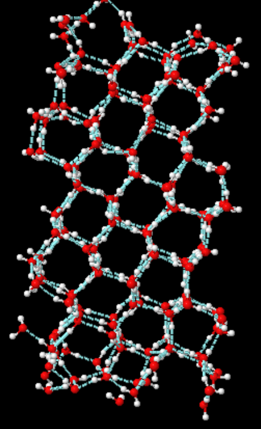
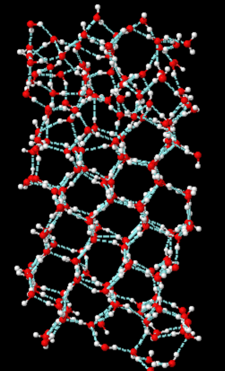
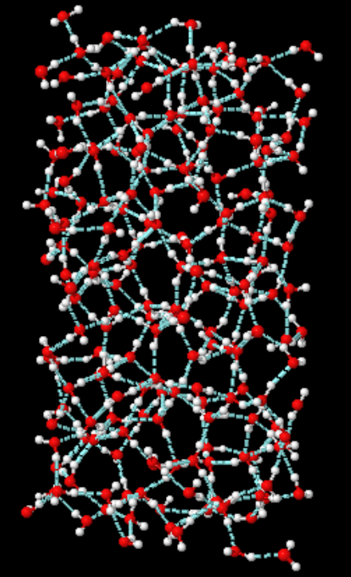
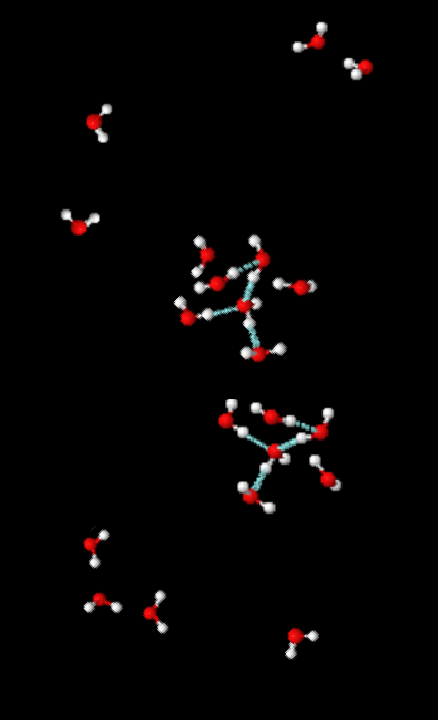
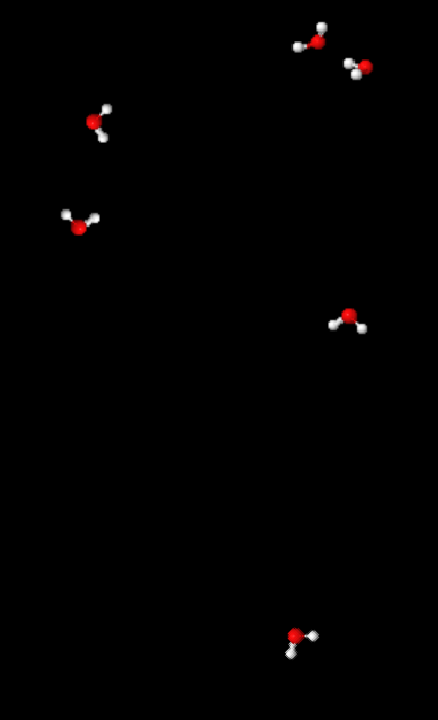

# Introduction
This chapter first discusses how macroscopic matter is built from its microscopic constituents and how it interacts with its surroundings. The discussion leads to the concepts of internal energy and equilibrium state, to the definitions for different boundary types, and to concepts of heat and work. The chapter then describes the state variables that are needed for a macroscopic description of matter. While doing so, the zeroth law of thermodynamics is encountered. Finally, the chapter closes by providing a roadmap to these lecture notes and a brief discussion on how thermodynamics and continuum mechanics are positioned with respect to each other and with respect to other classical fields of engineering.

##  Internal energy and equilibrium state 
Under close inspection, ordinary matter is observed to consist of particles such as atoms, molecules, and ions. All of these particles interact through forces that have origins in the Coulomb interactions between their charged constituents, namely electrons and nuclei. Even when particles carry no net electric charge, the internal distribution of positive and negative charge gives rise to effective interactions that can be attractive at moderate separations and strongly repulsive at very short separations. As a result, the interaction between two individual particles can be understood as a consequence of potential energy that has a minimum at a characteristic distance.

For a collection of particles, the collective effect of different interaction strengths and geometries leads to different macroscopic states. In a solid, particles typically reside close to each other and their preferred separations vibrating about equilibrium positions. In a liquid, particles reside close together and near their preferred separations but continually rearrange over time. In a gas, the average separation is large and interactions are weak except when particles briefly pass each other close by in an event that can be described as an instantaneous collision. For an illustration, the sketches in {numref}`fig-water-solid-liquid-vapor-molecules` show collections of water particles in various configurations. The macroscopic state of matter is therefore governed by a competition between the interparticle potential energy, which favours certain separations and arrangements, and the kinetic energy of the particles, which includes contributions from translational, rotational, and vibrational motion. The microscopic kinetic and interaction potential energies of the particles, excluding the center-of-mass kinetic energy, gravitational energy, and nuclear binding energy, are referred to as internal energy.

:::::{figure}
:label: fig-water-solid-liquid-vapor-molecules
:align: center
:class: my-subfigures grid grid-cols-5 items-end gap-2 

(water-solid)=

(water-melting)=

(water-liquid)=

(water-evaporating)=

(water-gas)=

Water in different configurations, with hydrogen bonds illustrated (cyan dashed lines).
:::::

As the motion of the particles in classical sense is governed by Newton's laws, the particles continually exchange energy and momentum through their interactions, the forces between them. A collection of particles is said to be in a thermodynamic equilibrium state when this exchange has led to a distribution of energies and configurations that appears time-independent when averaged over a short period of time. Although individual particles continue to move, interact, and exchange energy and momentum, the overall distribution of energies and configurations in an equilibrium state remains approximately steady in time.

##  Boundary types, heat, and work
Consider two collections of particles, each of which has settled into its own equilibrium state. Regard each such collection as a system. A boundary between systems is any surface that separates them and determines the mechanisms by which energy can be transferred between the systems.

A diathermal boundary allows energy to be transferred in a way that can change the energy or configuration distributions of the particles within systems, without requiring macroscopic motion of the boundary in system's rest frame. When two systems are separated by a diathermal boundary, they are said to be in thermal contact. Typical examples include two solid objects touching each other, a thin metal wall separating two volumes of liquid, and a solid object surrounded by air or liquid water. The portion of net energy transfer across a diathermal boundary that is mediated by microscopic motion of particles is referred to as heat. Heat therefore describes energy in transfer and is not a property contained within a system. Energy transfer across a diathermal boundary can be mediated also by, e.g, electromagnetic fields. By contrast, an adiabatic boundary prevents all energy transfer that would alter the energy or configuration distributions of the particles within the systems without macroscopic motion of the boundary between them. Practical examples include thick insulation, vacuum gaps, Faraday cages, or thin highly reflective material layers.

When two systems are separated by a movable boundary, they are said to be in mechanical contact. A typical example is a movable piston in a cylinder that separates the volume of gas inside the cylinder chamber from the outsides of it. By contrast, a stationary rigid boundary does not move, preventing mechanical contact. The energy transferred across a mechanical contact through macroscopic motion of the boundary is referred to as mechanical work. Like heat, mechanical work is energy in transfer and is not a property contained within a system.

In general, work is any energy transfer across a boundary that is not heat, including mechanical and electromagnetic field work. A boundary can also combine different types, allowing both heat and work to be exchanged, or neither.

##  Density, specific volume, and molar volume
A macroscopic description of matter should be consistent with experimental observations while remaining as simple as possible and expressible in terms of a small number of variables. Although the state of matter is determined from the microscopic energy and configuration distributions, a macroscopic description should not depend on the detailed positions and motions of individual particles, but instead capture their collective effect.

As the forces between particles depend strongly on the distances between them, and the motion of each particle in response to these forces depends on its mass, the macroscopic state of matter can be expected to depend on the mass--volume ratio of the system. This motivates introducing macroscopic variables referred to as density $\rho$ and specific volume $v$ via

:::{math}
:label: eq:chap-01:density-specific-volume
\rho=\frac{m}{V}, \qquad  v=\frac{V}{m} 
:::

Density measures how closely packed the particles are within the boundary, while specific volume indicates how much space is available per unit mass of matter. 

As different materials consist of different types of particles with different particle masses, it is sometimes useful to describe the ratio of volume $V$ to the number of particles $N$ rather than to the total mass. The typical number of particles in a macroscopic volume, however, is large, so one uses the Avogadro constant $N_A=6.02214076\times 10^{23}\,\text{mol}^{-1}$ and the number of moles $n$ instead of the absolute number of particles. This leads to a macroscopic variable definition referred to as molar volume 
:::{math}
:label: eq:chap-01:molar-volume
    V_m=\frac{V}{n}=N_A\frac{V}{N}=Mv,
:::
where the link to specific volume is provided by the molar mass $M=m/n$ of the matter. 

Although macroscopic quantities, density, specific volume, and molar volume can be defined for a collection of particles whether or not it is in an equilibrium state. The SI-units for the space and mass related quantities are listed in {numref}`tab:chap-01:-volume-mass-related-units`

:::{table} Units of volume and mass related quantities.
:label: tab:chap-01:-volume-mass-related-units
:align: center
:class: booktabs

| Symbol | Name | SI unit |
|:---:|:---|:---:|
| $V$ | Volume | $\text{m}^3$ |
| $m$ | Mass | $\text{kg}$ |
| $\rho$ | Density | $\text{kg}\,\text{m}^{-3}$ |
| $v$ | Specific volume | $\text{m}^3\,\text{kg}^{-1}$ |
| $M$ | Molar mass | $\text{kg}\,\text{mol}^{-1}$ |
| $V_m$ | Molar volume | $\text{m}^3\,\text{mol}^{-1}$ |
:::

##  Pressure
Consider then a cylinder filled with gas and closed with a piston, as in

##  A remark on solids and stress
While the interparticle forces acting across an imaginary surface within an equilibrium gas or liquid are strictly normal to that surface, regardless of the surface orientation, this is generally not true for solids. In a solid body, the forces transmitted across an internal imaginary surface through a point depend explicitly on the surface orientation. Consequently, the force per unit area at a given point is no longer invariant with direction and cannot be fully described by a single scalar value. 

##  The zeroth law and temperature
Where pressure, more generally stress, characterizes macroscopic description of the mechanical interactions within a system and across a boundary, one can ask whether a macroscopic characterization exists for interactions across a thermal contact.  To explore this, suppose two systems are separated by a diathermal boundary and are otherwise isolated from external influences. The systems are able to exchange heat. After some time, the interaction across the boundary no longer produces any net heat exchange and the systems settle into a mutual equilibrium. The two systems are then said to be in thermal equilibrium. 

##  A gas thermometer
While the zeroth law enables defining the concept of temperature, it does not directly provide a way to measure or calculate it. A detour is needed. 

##  Extensive and intensive quantities
The volume, mass, and internal energy of a system are extensive quantities, meaning they depend on the amount of matter in the system. In contrast, density, specific volume, molar volume, pressure, specific internal energy, and temperature are intensive quantities, which do not depend on the system size. If two systems with identical properties are combined, the extensive variables sum, while the intensive variables remain unchanged. Theories describing the behaviour of matter usually rely on intensive quantities and variables. 

##  Matter in motion
Matter, be it gas, liquid, or solid, doesn't have to remain still. Also its shape can change. Liquids and gases flow, hence they are called fluids, while solids may bend elastically and oscillate back and forth, or deform inelastically. Typically the macroscopic scale of the volume the matter occupies is vast in comparison to the interparticle distances, and the time scale of motion one observes is orders of magnitudes longer than the average time between inter-particle collisions. Under such conditions, different parts of macroscopic volumes of matter can be treated as individual systems connected by boundaries, with each system remaining in thermodynamic equilibrium state but potentially in a different one from the neighbouring system's state. The matter then is said to remain in a local thermodynamic equilibrium and thermodynamic relations between state variables are assumed to hold locally.

##  A roadmap for the course
The continuum mechanics framework can be built on three core principles: the measurement of observable quantities; the fundamental conservation laws of mass, momentum, and energy; and the natural tendency of local differences in macroscopic quantities to smooth out over time in the absence of external influences. 

