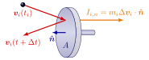
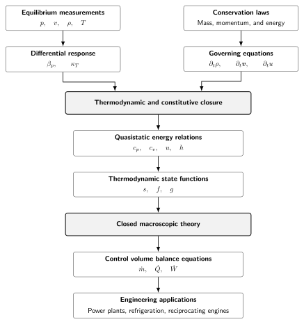

---
numbering:
  enumerator: "1.%s"
  heading_1: true
  heading_2: true
  heading_3: true
---

# 1 Introduction
This chapter first discusses how macroscopic matter is built from its microscopic constituents and how it interacts with its surroundings. The discussion leads to the concepts of internal energy and equilibrium state, to the definitions for different boundary types, and to concepts of heat and work. Here, these concepts are introduced without equations. Later, mathematics will provide the language for quantitative interpretation of the same ideas. The chapter then proceeds to describe the state variables that are needed for the macroscopic description of matter. While doing so, the zeroth law of thermodynamics is encountered, providing an interpretation for temperature. Before closing, the chapter briefly discusses how description for the motion of matter can take two different viewpoints, setting the premise for later analysis of fluid motion. Finally, a roadmap to these notes is provided together with a brief discussion on how thermodynamics and fluid mechanics are positioned with respect to each other. 

## Learning goals

Below one may find the learning goals for this chapter. Majority of the goals are chosen to support the core path, indicated in -color:

-  The reader recognizes the microscopic origin of internal energy.
-  The reader differentiates a thermal equilibrium state from a non-equilibrium state.
-  The reader recognizes heat and work as energy in transfer and differentiates between the two.
-  The reader lists the different boundary types a system can have, and classifies interaction of systems with their surroundings with the help of the boundary types.
-  The reader is able to convert between the different volume-variable variants (density, specific volume, molar volume).
-  The reader provides an interpretation for pressure.

-  The reader recalls the zeroth law of thermodynamics
-  The reader uses a gas thermometer to estimate temperature with respect to a reference temperature.

In addition, one intermediate and one advanced goal are included to prepare also the readers interested in progressing beyond the core topics:

-  The reader recognizes the difference between pressure and stress.
-  The reader differentiates between the Eulerian rate of change of velocity and the material (Lagrangian) rate of change of velocity for a flow.

##  Internal energy and equilibrium state 
Ordinary matter consists of particles such as atoms, molecules, and ions, which interact through forces that originate in electromagnetic interactions between their charged constituents. Even electrically neutral particles can attract or repel one another because of their internal charge distributions. These interactions give rise to a potential energy that depends on the relative positions and configurations of the particles, typically favouring certain separations over others.

The collective behaviour of many interacting particles gives rise to different macroscopic states of matter. In a solid, particles typically remain close to preferred positions, vibrating around them. In a liquid, particles remain close together but continually rearrange. In a gas, particles are typically far apart, with interactions becoming significant mainly during close encounters. The sketches in {numref}`fig-water-solid-liquid-vapor-molecules` illustrate water in these different configurations. The macroscopic state thus reflects the interplay between interaction potential energy, which favours certain particle arrangements, and kinetic energy associated with translational, rotational, and vibrational motion, trying to tear the matter apart.

The microscopic kinetic and interaction potential energies of the particles, excluding the kinetic energy of the particle collection's centre of mass, its gravitational potential energy, and nuclear binding energy, constitute its internal energy. In these notes, the symbol $U$ is reserved to denote the internal energy of a collection of particles.

:::::{figure}
:label: fig-water-solid-liquid-vapor-molecules
:align: center
:class: my-subfigures grid grid-cols-5 items-end gap-2 

(water-solid)=

(water-melting)=

(water-liquid)=

(water-evaporating)=

(water-gas)=

Water in different configurations, with hydrogen bonds illustrated (cyan dashed lines).
:::::

As the particles move and interact, they exchange energy and momentum. A collection of particles is said to be in a thermodynamic equilibrium when its macroscopic properties and statistical distributions remain stationary in time, despite the continuing microscopic motion and interactions. In equilibrium, individual particles still exchange energy and momentum, but the overall statistical description remains unchanged.

As internal energy describes the total microscopic kinetic and interaction potential energy in the particle collection's centre-of-mass frame, it does not, by itself, specify how that energy is distributed among the particles. Consequently, internal energy can be defined for both equilibrium and non-equilibrium particle collections.

##  Boundary types, heat, and work

Consider two collections of particles, each of which has settled into its own equilibrium state. Regard each collection as a system. A boundary separates a system from its surroundings or another system and determines the mechanisms by which energy can be transferred across it.

A diathermal boundary permits energy transfer that changes the microscopic energy or configuration distributions of the particles without requiring macroscopic displacement of the boundary in the system's rest frame. Two systems separated by such a boundary are said to be in thermal contact. Practical examples include two solid objects touching each other and a thin metal wall separating two volumes of liquid. The portion of energy transferred across a diathermal boundary through microscopic interactions between particles, or through radiation that is emitted by a system in thermal equilibrium, is referred to as heat. Heat therefore is energy in transfer, not a property contained within a system.

An adiabatic boundary prevents heat transfer. This idealization can be approximated by sufficiently thick insulation, although perfect insulation can never be achieved in practice. An adiabatic boundary does not necessarily prevent other forms of energy transfer across the boundary.

When two systems interact through forces acting across a movable boundary, energy can be transferred through the macroscopic displacement of that boundary. This mode of energy transfer is referred to as mechanical work. A typical example is a movable piston in a cylinder, separating the gas inside the cylinder from its surroundings. As the piston moves under the action of forces, energy is transferred through work at the boundary. A boundary that is stationary with respect to the system's rest frame and rigid cannot transfer energy through its own displacement. Like heat, mechanical work is energy in transfer rather than a property of a system.

More generally, work denotes energy transfer by mechanisms other than heat. Besides mechanical work, it includes energy transfer associated with electromagnetic fields. A boundary may permit both heat and work transfer, or prevent one or both, depending on its properties.

##  Density, specific volume, and molar volume

A macroscopic description of matter should be consistent with experimental observations while remaining as simple as possible and expressible in terms of a small number of variables. Although the state of matter is determined by its microscopic energy and configuration distributions, a macroscopic description should not depend on the detailed positions and motions of individual particles, but instead capture their collective effects.

For a given material, the mass and volume of a system scale together as the amount of matter changes. This motivates introducing the mass per unit volume, called density $\rho$, and the volume per unit mass, called specific volume $v$, as macroscopic variables:

:::{math}
:label: eq:chap-01:density-specific-volume
\rho=\frac{m}{V}, \qquad  v=\frac{V}{m} 
:::

Density and specific volume are reciprocals. They describe the amount of mass associated with a given volume, and the volume associated with a given mass, respectively.

As different materials consist of different types of particles with different particle masses, it is sometimes useful to describe the ratio of volume $V$ to the number of particles $N$, rather than to the total mass. Since the number of particles in a macroscopic system is typically very large, the amount of substance $n$ is used instead, with the Avogadro constant $N_A=6.02214076\times 10^{23}\,\text{mol}^{-1}$ relating the two through $n=N/N_A$. This motivates the definition of molar volume:

:::{math}
:label: eq:chap-01:molar-volume
    V_m=\frac{V}{n}=N_A\frac{V}{N}=Mv,
:::
where $M=m/n$ is the molar mass. 

Density, specific volume, and molar volume can be defined for a collection of particles whether or not it is in thermodynamic equilibrium. The SI units of these and the related mass and volume quantities are listed in {numref}`tab:chap-01:volume-mass-related-units`.

:::{table} Units of volume and mass related quantities.
:label: tab:chap-01:volume-mass-related-units
:align: center
:class: booktabs

| Symbol | Name | SI unit |
|:---:|:---:|:---:|
| $V$ | Volume | $\text{m}^3$ |
| $m$ | Mass | $\text{kg}$ |
| $\rho$ | Density | $\text{kg}\,\text{m}^{-3}$ |
| $v$ | Specific volume | $\text{m}^3\,\text{kg}^{-1}$ |
| $M$ | Molar mass | $\text{kg}\,\text{mol}^{-1}$ |
| $V_m$ | Molar volume | $\text{m}^3\,\text{mol}^{-1}$ |
:::

##  Pressure
Consider then a cylinder filled with gas and closed with a stationary piston, as in {numref}`fig-pressure-piston-cylinder`. A gas particle that interacts with the piston changes its velocity over a short time interval and, according to Newton’s laws, imparts a small impulse to the piston. On macroscopic times scales, such collisions in a gas appear to occur extremely frequently, and the cumulative effect of many impulses produces a force that, on macroscopic time scales, appears continuous in time. To keep the piston from moving, an opposing force must be applied normal to the piston surface.

:::::{figure}
:label: fig-pressure-piston-cylinder
:align: center
:class: my-subfigures grid grid-cols-2 items-end gap-2

(pressure-piston)=

(pressure-cylinder)=

(a) A gas particle imparts impulse on a piston. (b) A force equivalent to the effect of the impulses is need to keep the piston in place.
:::::

The magnitude of this force depends on both the state of the gas within the cylinder and the area of the piston surface over which the particles interact. This motivates defining pressure as a macroscopic property that characterizes the mechanical effect of a system on a surface. For a liquid or gas in equilibrium, pressure is the normal force per unit area exerted by the substance on a surface. Locally at a point, it is defined as

:::{math}
:label: eq:chap-01:pressure-as-normal-force
    \lim_{A\to 0}\frac{F_n}{A}=p.
:::
where $F_n$ is the normal force exerted on a surface element of area $A$ containing the point of interest. The SI-units for the pressure related quantities are listed in {numref}`tab:chap-01:pressure-related-units`. While the SI-unit for pressure is $\text{Pa}$, in engineering applications a more common unit is $1\,\text{bar}=10^5\,\text{Pa}$.

:::{table} Units of pressure related quantities.
:label: tab:chap-01:pressure-related-units
:align: center
:class: booktabs

| Symbol | Name | SI unit |
|:---:|:---:|:---:|
| $F$ | Force | $\text{N}$ |
| $A$ | Area | $\text{m}^2$ |
| $p$ | Pressure | $\text{Pa}\,(=\text{N}\,\text{m}^{-2})$ |
:::

If the piston is pushed inward by increasing the applied force, the volume of the gas decreases. Under sufficiently strong compression, part of the gas may condense into a liquid, so that the cylinder contains both liquid and gas. Because the liquid and gas have different densities, gravity can cause them to stratify and form a liquid-gas interface. For a flat interface at rest, the pressures in the liquid and gas sides are equal. At a curved liquid-gas interface, such as the surface of a small droplet or bubble, a surface tension force can balance a pressure difference between the liquid and the gas.

The surface on which pressure is defined therefore need not be a solid wall, such as the piston surface. An imaginary surface drawn within a gas or liquid also suffices. Momentum is transferred across such a surface through the microscopic motion and interactions of particles, giving rise to a macroscopic normal force per unit area. Pressure is thus a macroscopic property of the substance, not a property of a particular container wall. It can nevertheless be measured using a piston that compresses the gas or liquid.

##  A remark on solids and stress

While the macroscopic force per unit area acting across an imaginary surface within a liquid or gas undergoing uniform motion is normal to the surface, regardless of the surface orientation, this need not be true for solids in general or for liquids and gases undergoing nonuniform motion. Therefore, a tensor-valued quantity $\bm{\sigma}$, called the stress tensor, is generally needed to connect the force $\bm{F}$ per unit area to the surface normal $\bm{\hat{n}}$:

:::{math}
    \lim_{A\to 0}\frac{\bm{F}}{A}=\bm{\sigma}\cdot\bm{\hat{n}}.
:::

Here $A$ is the area of a surface element shrinking around the point of interest, with its orientation determined by $\bm{\hat{n}}$ and held fixed. The tensor $\bm{\sigma}$ enables the directions of $\bm{\hat{n}}$ and $\bm{F}$ to differ and description of forces that, for example, resist shearing in a flowing liquid or result from material anisotropy in solids. 

In these notes, the stress tensor will be encountered again when the equations describing fluid motion are derived. It also appears implicitly in the mechanical work rate terms of the engineering formulas used in power plant and refrigeration cycle analysis. While appearing to be a mathematical abstraction, the tensor description of contact forces on surfaces is a necessity implied by Newton's laws.

##  The zeroth law and temperature

Where pressure, and more generally stress, characterizes the macroscopic description of mechanical interactions within a system and across a boundary, one may ask whether a macroscopic property also characterizes thermal interactions across a boundary. To explore this, suppose two systems are separated by a diathermal boundary and are otherwise isolated from external influences. The systems can exchange heat. After some time, the net heat transfer between them ceases, and they reach thermal equilibrium. The two systems are then said to be in thermal equilibrium with each other.

The zeroth law of thermodynamics states that thermal equilibrium is transitive: if system A is in thermal equilibrium with system C, and system B is also in thermal equilibrium with system C, then systems A and B are in thermal equilibrium with each other. The zeroth law allows one to introduce a macroscopic property called temperature, denoted by $T$, which has the same value for systems in thermal equilibrium. Conversely, systems with the same temperature are in thermal equilibrium with each other.

##  A gas thermometer
The zeroth law enables defining the concept of temperature but it does not directly provide a way to measure or calculate it. A detour is needed. To quantify the temperature $T$ of a system, one may place a gas-filled bulb in thermal contact with the system, connect the gas to a manometer, as illustrated in {numref}`fig-gas-thermometer`. According to the zeroth law, the gas in the bulb will reach thermal equilibrium with the system and thus have the same temperature $T$. 

:::::{figure}
:label: fig-gas-thermometer
:align: center

A gas-filled bulb in thermal contact with a system and connected to a manometer. The manometer measures the gas pressure and volume.
:::::

By changing the gas volume while keeping the system's state unchanged, one may observe different pairs of gas pressure $p$ and volume $V$, all corresponding to the same system temperature. Repeating such measurements at different system temperatures provides the basis for establishing a reproducible relationship between the gas state and temperature:

:::{math}
    T = f(p,V).
:::

Experiments with sufficiently dilute gases show that, for a fixed amount of gas at a fixed temperature, the product $pV$ is approximately constant. As the gas density tends to zero, this product approaches a limiting value that depends on temperature and the amount of gas but not on the particular gas used. This motivates a relation of the form

:::{math}
    pV = g(T),
:::

where $g(T)$ is a function of temperature (and the gas amount) alone.

One may then choose a reference state for the gas and label its temperature, pressure, and volume as $T_\text{ref}$, $p_\text{ref}$, and $V_\text{ref}$, respectively. For any other state of the gas with pressure $p$ and volume $V$, the temperature $T$ then satisfies
:::{math}
    \frac{g(T)}{g(T_\text{ref})} = \frac{pV}{p_\text{ref}V_\text{ref}}.
:::
Since the zeroth law does not uniquely determine a numerical temperature scale, one may choose the scale so that $g(T)$ is proportional to $T$: 
:::{math}
    g(T) = \text{const}\times T,
:::
This choice defines a temperature scale such that the temperature of the system can be determined by measuring the pressure and volume of the gas and comparing them to the reference values
:::{math}
    \frac{T}{T_\text{ref}} = \frac{pV}{p_\text{ref}V_\text{ref}}.
:::

A convenient reference temperature is the temperature of the triple state of water, at which solid, liquid, and gaseous water coexist in equilibrium. Historically, this temperature was assigned the exact value $T_\text{ref}=273.16\,\text{K}$, providing a reference for the Kelvin temperature scale. Another commonly used temperature scale is the Celsius scale, related to the Kelvin scale by

:::{math}
T[^\circ\text{C}]=T[\text{K}]-273.15.
:::

::::{proof:example}
:label: example:chap-01:gas-thermometer
A gas thermometer uses mercury with a density of $\rho_\text{Hg}=13.59\,\text{g}\,\text{cm}^{-3}$ as the liquid substance. The inner diameter of thermometer capillary is $d=1\,\text{mm}$. With an ambient pressure of $p_\text{atm}=1.013\,\text{bar}$, a reference measurement corresponding to a temperature of $T_\text{ref}=273.16\,\text{K}$ provides a value of $V_\text{ref}=4.19\,\text{cm}^3$ for the gas volume and a value of $h_\text{ref}=89\,\text{mm}$ for the mercury column height difference in the capillary. A measurement of a different sample provides a value of $h=45\,\text{mm}$ for the mercury column height difference.

To determine the sample temperature, one calculates the pressure inside the thermometer bulb implied by the measurements. Assuming the gas pressure exceeds atmospheric pressure, the pressure inside the thermometer is the atmospheric pressure plus the hydrostatic pressure corresponding to the mercury-level difference. Thus,

:::{math}
:enumerated: false

p_\text{ref} & =p_\text{atm}+\rho_\text{Hg} g h_\text{ref}=1.132\,\text{bar}\\
p & =p_\text{atm}+\rho_\text{Hg} g h=1.073\,\text{bar}

:::

The change in the gas volume from the reference state \(V_\text{ref}\) is calculated from the capillary cross sectional area and the change in the mercury column height

:::{math}
:enumerated: false
V=V_\text{ref}+\frac{1}{4}\pi d^2(h-h_\text{ref})=4.155\,\text{cm}^3.
:::

The sample temperature inferred from the gas-thermometer measurements then is
:::{math}
:enumerated: false
T=T_\text{ref}\frac{pV}{p_\text{ref}V_\text{ref}}=256.86\,\text{K}=-16.29^\circ\text{C}
::::

##  Extensive and intensive quantities

The volume, mass, and internal energy of a system are extensive quantities: when two systems in the same state are combined, their values add. In contrast, density, specific volume, molar volume, pressure, specific internal energy, and temperature are intensive quantities: their values remain unchanged when identical systems in the same state are combined.

Descriptions of matter often use intensive quantities to characterize its state, while extensive quantities account for the total amount of matter and energy in a system. To distinguish these quantities, these notes use plain upper-case symbols for extensive quantities, plain lower-case symbols for quantities expressed per unit mass, and upper-case symbols with a subscript $m$ for quantities expressed per mole, as summarized in {numref}`tab:chap-01:extensive-intensive-convention`. Temperature $T$ and pressure $p$ are exceptions to the symbol-case convention; mass $m$ is an extensive quantity denoted by a lower-case symbol.

:::{table} Extensive and intensive symbol conventions for matter-related quantities.
:label: tab:chap-01:extensive-intensive-convention
:align: center
:class: booktabs

| Type | Symbol | unit |
|:---|:---:|:---:|
| Extensive | $A$ | $[A]$ |
| Intensive (per unit mass) | $a$ | $[A]\,\text{kg}^{-1}$ |
| Intensive (per mole) | $A_m$ | $[A]\,\text{mol}^{-1}$ |
:::

##  Matter in motion

Matter, whether gas, liquid, or solid, can move and change shape. Liquids and gases can flow and are therefore called fluids, whereas solids resist deformation and may respond elastically or undergo permanent deformation. The description of matter and its motion at macroscopic scales relies on the fact that the characteristic length and time scales of interest are typically much larger than the microscopic scales associated with interparticle distances and collisions. 

This scale separation allows matter to be described in terms of a continuum theory, where macroscopic properties are interpreted as fields that depend on position $\bm{x}$ and time $t$. These include not only the state variables density, pressure, and temperature but also the velocity field $\bm{v}(\bm{x},t)$, which describes the local macroscopic motion of matter. The evolution of the fields is then described by conservation laws for mass, momentum, and energy, together with appropriate constitutive relations and an assumption of thermodynamic equilibrium to be a valid approximation locally in the matter.

In classical mechanics of point particles or rigid bodies, one studies the motion of a fixed mass under the action of forces. The corresponding material description in continuum mechanics follows a volume containing the same matter as it moves and deforms. Such a volume is called a material volume. Remote forces, such as gravity, act throughout the volume, whereas contact forces act across its boundary. This description, called material or Lagrangian, is convenient for solids, whose deformation can often be described relative to an initial configuration.

An alternative is to describe the fields at fixed locations in space. This is called the Eulerian description. Rather than following a particular material volume, one observes how matter flows through a chosen spatial region and how its properties change there. This description is often convenient for fluids, which can undergo substantial deformation and continuously exchange matter with a fixed region of space. The Lagrangian and Eulerian descriptions are complementary ways of describing the same continuum motion.

In the Lagrangian description, the trajectory $\bm{x}(t)$ of a material point is determined by the velocity field through the ordinary differential equation

:::{math}
\frac{d\bm{x}(t)}{dt}=\bm{v}(\bm{x}(t),t).
:::

The solution specifies the position of the material point at each time, given its initial position. For a steady velocity field, these trajectories coincide with the integral curves of the field. For an unsteady field, the trajectories depend on the time evolution of the field. Differentiating the velocity along a trajectory gives the material acceleration,

:::{math}
\frac{d^2\bm{x}(t)}{dt^2}&=\frac{d}{dt}\bm{v}(\bm{x}(t),t)=(\partial_t\bm{v}+(\bm{v}\cdot\nabla)\bm{v})\big|_{(\bm{x}(t),t)},
:::

where the notation indicates the fields on the right-hand side are evaluated at $(\bm{x}(t),t)$. The first term $\partial_t\bm{v}$ describes the local Eulerian time rate of change of the velocity, at a fixed spatial location. The second term, $(\bm{v}\cdot\nabla)\bm{v}$, accounts for spatial variation of the velocity field along the trajectory needed in addition to the Eulerian rate to describe the Lagrangian rate of change of velocity. Notably, the material acceleration can be nonzero even when the velocity field does not change with time at any fixed location ($\bm{v}=\bm{v}(\bm{x})$), illustrating the differences between the Eulerian and Lagrangian viewpoints.

::::{proof:example}
:label: example:chap-01:lagrangian-acceleration

Consider the steady two-dimensional velocity field

:::{math}
:enumerated: false
\bm{v}(\bm{x})=v_0\bm{\hat{x}}+ v_0\frac{xy}{L^2}\bm{\hat{y}},
:::

where $v_0$ and $L$ are positive constants.

The velocity field is independent of time, so $\partial_t\bm{v}=0$. Nevertheless, the material acceleration is generally nonzero because the velocity varies with position. For a trajectory $\bm{x}(t)=x(t)\bm{\hat{x}}+y(t)\bm{\hat{y}}$, the acceleration is

:::{math}
:enumerated: false
\frac{d^2\bm{x}(t)}{dt^2}=((\bm{v}\cdot\nabla)\bm{v})\big|_{\bm{x}(t)}=\frac{v_0^2}{L}\left(1+\frac{x(t)^2}{L^2}\right)\frac{y(t)}{L}\bm{\hat{y}}.
:::

This example illustrates that a steady Eulerian velocity field does not imply zero material acceleration. A material point can experience a change in velocity as it moves through regions where the velocity field varies spatially.
::::

## A roadmap to the notes

The study of fluids and energy conversion brings together three kinds of knowledge: measurements of observable properties, conservation laws governing macroscopic motion, and constitutive relations describing how matter responds to changes in its state and surroundings. Measurements establish the relations between thermodynamic properties, conservation laws determine how macroscopic quantities evolve, and constitutive relations describe the transport of momentum and energy and the response of matter to deformation and heating.

For fluids in thermodynamic equilibrium, measurements provide values of pressure $p$, specific volume $v$ or density $\rho$, and temperature $T$. From such measurements, one may establish how these properties depend on one another, for example through the thermal expansion coefficient $\beta_p$ and the isothermal compressibility $\kappa_T$. Such information provides the starting point for constructing thermodynamic state relations.

Applying conservation laws to material volumes yields the governing equations for the evolution of mass, momentum, and energy. In a continuum description, these equations involve fields such as density $\rho$, velocity $\bm{v}$, and specific internal energy $u$. However, conservation laws alone do not provide a closed predictive model. Constitutive relations for stresses and heat fluxes, together with thermodynamic relations between state properties, are also required.

The thermodynamic relations needed for this closure are developed by studying measurements and energy conservation in quasistatic processes. These processes provide a way to investigate how heat transfer and mechanical work relate to changes in the thermodynamic state. The analysis introduces the specific heat capacities $c_p$ and $c_v$, establishes internal energy $u$ as a state function, and leads to an additional state function, the specific enthalpy $h$. These quantities describe how a substance stores energy and how its thermodynamic state responds to changes in temperature, pressure, and volume.

Further analysis of quasistatic processes reveals restrictions on the transformations between thermodynamic states. The mathematical structure of these restrictions leads to the introduction of entropy $s$, followed by the thermodynamic potentials known as the specific Helmholtz free energy $f$ and the specific Gibbs free energy $g$. These state functions provide alternative descriptions of the same thermodynamic system and are particularly useful for constructing computational models of fluid properties.

With thermodynamic and constitutive closure established, the continuum equations become a predictive framework for fluid motion and energy transfer. Thermodynamic property models, including those implemented in numerical property libraries, supply the state relations needed to evaluate fluid properties from suitable combinations of temperature, pressure, and volume. The resulting framework combines mass, momentum, and energy balances with thermodynamic relations to analyze engineering systems. Together, fluid mechanics and thermodynamics provide the foundations for understanding and designing pumps, fans, compressors, turbines, heat exchangers, heat pumps, power plants, and internal combustion engines, though mass-flow rates $\dot{m}$, heat rates $\dot{Q}$, and mechanical work rates $\dot{W}$. As a whole this process path is illustrated in {numref}`fig-roadmap`. 

:::::{figure}
:label: fig-roadmap
:align: center

A roadmap to the notes.
:::::
