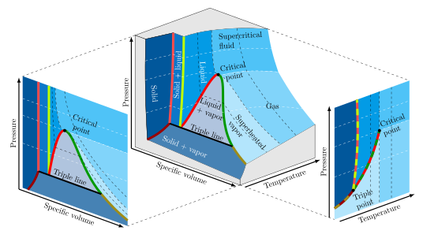
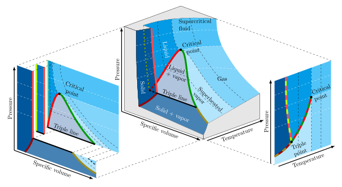
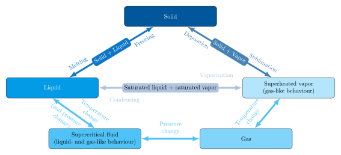
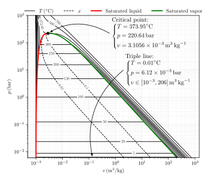
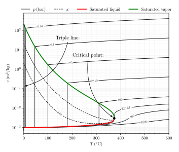
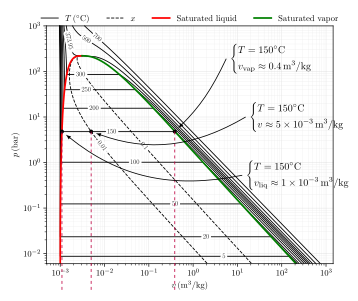
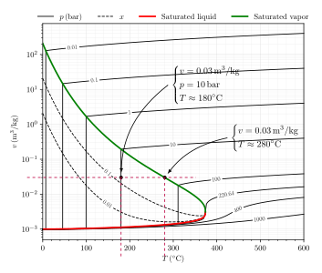
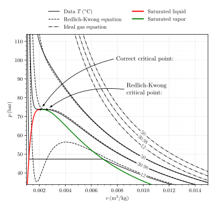

# Properties of Pure Substances

This chapter first introduces relations between state variables of pure substances using illustrative phase diagrams. The diagrams provide the reader an overview of how substances generally behave, and what common features are shared among them. Predictive models are then introduced, first with simple analytical equations of state, then through numerical property libraries. The analytical models serve to explain observations in the phase diagrams, help in design of experimental measurements of unknown substances, and support intuition of substance behaviour. The numerical property libraries, on the other hand, are the gold standard for engineering modeling and provide accuracy when required. From the property observations and models, the reader is introduced to the state-variable response coefficients that are needed later in developing the thermodynamic framework. Finally, a principle of corresponding states is discussed to help in predicting properties of unknown substances with the properties of known substances' data.

## Learning goals

The learning goals for this chapter are listed below. The goals to support the core path are:

- <span class="elementary"></span> The reader identifies locations of critical point, triple line, and phase transition lines in phase diagrams of pure substances.
- <span class="elementary"></span> The reader recalls the different phases of ordinary matter, the transitions between them, and is able to sketch phase diagrams.
- <span class="elementary"></span> The reader calculates vapor quality of a state point on a given $p$-$v$ or $v$-$T$ diagram.
- <span class="elementary"></span> The reader uses simple analytical equations of state to evaluate state variables.
- <span class="elementary"></span>  Using measured data, the reader predicts substance critical point with a Van der Waals model or another two-parameter model.
- <span class="elementary"></span> The reader calculates the compressibility factor from given data to estimate the validity of ideal gas model.

The goals to support the intermediate and advanced paths are:

- <span class="intermediate"></span>  The reader uses pyromat or coolprop to calculate pressure, density, or temperature for a given state point.
- <span class="intermediate"></span>  The reader estimates the isobaric thermal expansion and the isothermal compressibility coefficients from $p$-$v$ or $v$-$T$ diagrams for a given state point.
- <span class="advanced"></span> The estimates saturation properties with analytical equations of state subjected to the Maxwell construct.
- <span class="advanced"></span> The reader manipulates differential forms to obtain relations between partial derivatives.
- <span class="advanced"></span> The reader programs a python script utilizing pyromat or coolprop to create a $p$-$v$ or a $v$-$T$ diagram.

## <span class="elementary"></span> The p-v-T phase diagram
In mechanics, matter is classified into solid states that can sustain shape under shearing forces and into fluid states that cannot. In engineering thermodynamics, fluid states are classified not only into liquid and gas states but subclassified further into superheated vapor and supercritical fluid states. In short, superheated vapor is gaseous while supercritical fluid has characteristics of both liquid and gas. Also mixtures of solid, liquid, and gas states in common thermodynamic equilibrium are encountered. In a three-dimensional space with pressure $p$, specific volume $v$, and temperature $T$ as coordinates, thermodynamic states of a pure substance form a two-dimensional, so-called $p$-$v$-$T$ surface. Schematic illustrations of such surfaces are provided in {numref}`fig-pvT`, with temperature and pressure isocontours, i.e., isotherms and isobars, drawn with black and white dashed curves.

:::::{figure}
:label: fig-pvT
:align: center
<!-- :class: my-subfigures grid grid-cols-5 items-end gap-2 --> 

(fig-pvT-expanding)=


(fig-pvT-contracting)=


Schematic $p$-$v$-$T$ diagrams for pure substances that expand (top) or contract (bottom) during melting.
:::::

Important classifiers are observed in {numref}`fig-pvT`. First is the critical point with pressure $p_\text{crit}$, temperature $T_\text{crit}$, and specific volume $v_\text{crit}$. At temperatures above that of the critical point, a gaseous state is referred to as gas and cannot be condensed into a liquid by increasing the pressure alone. This has important consequences for the design of engineering applications that often rely on phase transitions. At temperatures below that of the critical point, a gaseous state is labelled as superheated vapor and can be condensed into liquid by increasing the pressure alone. If both pressure and temperature are above those of the critical point, the fluid state is labelled as supercritical. Second is the triple line that, if projected onto the $p$-$T$ plane, is observed to reduce into a single point. This indicates that the triple line is characterized by a single pressure value $p_\text{trp}$, a single temperature value $T_\text{trp}$, and a range of values for specific volume. For pressure values below that of the triple line, a stable liquid phase does not exist. Further important classifiers in {numref}`fig-pvT` are the thick colored curves that separate single-phase regions from two-phase regions and, when projected onto the $p$-$T$ plane, form the two-colored co-existence curves representing mixtures of two phases. For convenience, the labels for the single-phase regions, the mixture-phase regions, and the names of the transitions between them are illustrated also in {numref}`fig-pvT-labels`.

:::::{figure}
:label: fig-pvT-labels
:align: center
<!-- :class: my-subfigures grid grid-cols-5 items-end gap-2 --> 



Labels of the single-phases regions and the transitions between them.
:::::

Following the isobars and isotherms on the $p$-$v$-$T$ surface, one may build understanding of the substance behaviour. For pressure values below that of the triple line, keeping the pressure constant while decreasing the temperature of a gas results in reduction of the gas volume, until vapor begins to deposit into a solid. A phase-mixture of gaseous vapor and solid in a thermodynamic equilibrium then forms, with pressure and temperature common for both phases. If volume is then reduced while keeping the temperature constant, also pressure remains constant until all of the vapor is deposited into solid. After that, further reduction of temperature at constant pressure can continue while the substance state remains in solid phase, leading typically to minor reduction in the substance volume. 

For pressure values above that of the triple line but below that of the critical point, keeping the pressure constant while decreasing the gas temperature again leads to decrease in the gas volume, until the vapor starts condensing into liquid. A phase-mixture of liquid and vapor then forms, with pressure and temperature common for both phases. If the volume is then reduced while keeping temperature constant, pressure remains constant until all vapor has condensed into liquid. Reducing temperature at constant pressure can then continue, until liquid at some point begins to freeze into solid. For many substances, the phase-mixture of solid and liquid under constant temperature and pressure reduces in volume upon freezing but for some, like water, freezing leads to expansion in substance volume instead. This behaviour is observed also in {numref}`fig-pvT`. Once all of the liquid has frozen into solid, temperature can be further reduced at constant pressure, leading again typically to a reduction of the substance volume. At pressures above that of the critical point, no phase boundary nor coexistence curve exists between gas- and liquid-like phases. Instead, the transition is continuous and happens in a single phase. 

The phase-mixture regions might seem somewhat exotic at first but are not. A region where two phases coexist in equilibrium can be obtained, e.g., by placing a kettle filled with liquid water on a stove and turning the heat on. Once the water starts boiling, water vapor forms and fills the remaining space under the kettle lid, pushing air out. A mass of water then exists within a volume in both liquid and vapor states, sharing a common temperature and pressure. Because liquid water has higher density than water vapor, gravity separates the liquid and vapor phases into physically different regions within the kettle. As a system, the water in the kettle nevertheless has one mass and one volume, and therefore, as a system, can be assigned a single specific volume or density value, corresponding to a state. In this respect the triple line is a unique collection of states. As the line separates two phase-transition regions, matter on the line can exist simultaneously in all three primary phases, as solid, liquid, and gaseous vapor.

## <span class="elementary"></span> The p-v and v-T diagrams, vapor quality
Most engineering applications involve fluids at pressures above that of the triple line. To represent the fluid state and the associated isotherms and isobars quantitatively, the $p$–$v$ and $v$–$T$ projections replace the schematic $p$–$v$–$T$ surface, as shown for water in {numref}`fig-pv-vT-H2O`. Particular attention is given to the two-phase region, representing mixtures of liquid and vapor, and to the behaviour of temperature and pressure isocontours in the $p$–$v$ and $v$–$T$ planes.

:::::{figure}
:label: fig-pv-vT-H2O
:align: center
<!-- :class: my-subfigures grid grid-cols-5 items-end gap-2 --> 

(fig-pv-T-H2O)=

(fig-vT-p-H2O)=


The $p$-$v$ (top) and $v$-$T$ (bottom) diagrams for water, with critical point and triple line indicated.
:::::

In the $p$-$v$ and $v$-$T$ diagrams of {numref}`fig-pv-vT-H2O`, the red curve denotes the saturated liquid states, while the green curve represents the saturated vapor states. The two curves start from the opposing ends of the triple line and meet at the critical point. Together they form the saturation curve which, together with the triple line, encloses the liquid-vapor two-phase region. Elsewhere the fluid exists in single phase. Although {numref}`fig-pv-vT-H2O` is specific to water, the same definitions and qualitative behavior apply to all pure substances. 

As disccussed in connection with the $p$-$v$-$T$ surface, temperature and pressure both remain constant during a phase transion when volume change is not constrained. This is reflected in both the $p$-$v$ and the $v$-$T$ diagram. In the $p$-$v$ diagram, isotherms are horizontal in the two-phase region, and the phase transition appears as a horizontal line between the saturated liquid and saturated vapor states. In the $v$-$T$ diagram, the roles are reversed. Isobars are vertical within the two-phase region, and the phase transition appears as a vertical line between the saturated liquid and saturated vapor states.

What changes during a phase transition is the specific volume of a substance, and a quantity referred to as vapor quality. In a volume $V$ containing mass $m$ in a two-phase state, the liquid will occupy a volume $V_\text{liq}$ and have mass $m_\text{liq}$ while the vapor will occupy a volume $V_\text{vap}$ and have mass $m_\text{vap}$. Naturally, the volumes and masses sum together according to

:::{math}
    V_\text{liq}+V_\text{vap}=V, \qquad 
    m_\text{liq}+m_\text{vap}=m.
:::

On the saturated liquid curve, no vapor exists at all while on the saturated vapor curve, only vapor exists. To reflect this behaviour, vapor quality is defined as the ratio of the vapor mass to the total fluid mass

:::{math}
    x=\frac{m_\text{vap}}{m}=\frac{m_\text{vap}}{m_\text{liq}+m_\text{vap}}.
:::

The liquid and vapor parts have specific volumes corresponding to the respective states at the saturated liquid and vapor curves 

:::{math}
    v_\text{liq}=\frac{V_\text{liq}}{m_\text{liq}}, \qquad 
    v_\text{vap}&=\frac{V_\text{vap}}{m_\text{vap}}, 
:::

and a state in the two-phase region, having vapor quality $x$, can be shown to have a specific volume of

:::{math}
    v=(1-x)v_\text{liq}+x\,v_\text{vap}.
:::

Conversely, the vapor quality in the two-phase region can be determined from the specific volume with

:::{math}
    x=\frac{v-v_\text{liq}}{v_\text{vap}-v_\text{liq}}.
:::

Chosen isocontours of the vapor quality defined in this manner are drawn in the $p$-$v$ and $v$-$T$ diagrams of water in {numref}`fig-pv-vT-H2O` with black dashed lines. One should remember that the vapor quality is specified only within the two-phase region and with values $x\in[0,1]$.

::::{proof:example}
:label: vapor-quality-from-pv-diagram

Hot steam at $T=150^\circ\text{C}$ is produced for an industrial process by boiling water with an electric resistance heater within a pressure vessel. The pressure vessel has a volume of $1000\,\ell$ and the liquid water inside is observed to occupy a volume of $200\,\ell$. Estimate the mass of water vapor inside the pressure vessel and calculate the vapor quality for the water in the vessel.

From the $p$-$v$ diagram in {numref}`fig-pv-T-H2O`, one can estimate the specific volumes of saturated liquid and saturated vapor using the $150^\circ\text{C}$ isotherm and the saturated liquid and vapor curves:
$$
	v_\text{liq}&\approx 1\times 10^{-3}\,\text{m}^3/\text{kg}, &
	v_\text{vap}&\approx 4\times 10^{-1}\,\text{m}^3/\text{kg}.
$$
Using the definition of specific volume, the masses of liquid water and water vapor are then calculated from the volumes and the specific volumes
$$
	m_\text{liq}&=\frac{V_\text{liq}}{v_\text{liq}}\approx 200\,\text{kg}, &
	m_\text{vap}&=\frac{V_\text{vap}}{v_\text{vap}}=\frac{V-V_\text{liq}}{v_\text{vap}}\approx 2\,\text{kg},
$$
and the total mass of water inside the pressure vessel can be calculated to be $m\approx202\,\text{kg}$. The specific volume for the water inside the vessel is therefore $v=V/m\approx 5\times 10^{-3}\,\text{m}^3/\text{kg}$ and the vapor quality is calculated to be
$$
	x=\frac{v-v_\text{liq}}{v_\text{vap}-v_\text{liq}}\approx 0.01.
$$
The points from which the values used are obtained are illustrated below.

:::{figure}
:align: center



:::
::::


::::{proof:example}
:label: vapor-temperature


A pressure vessel with a volume of $30\,\text{m}^3$ contains $1000\,\text{kg}$ of water at a pressure of $p=10\,\text{bar}$. What is the temperature of water in the vessel? At what temperature would all water in the vessel become vapor?

The specific volume of water in the vessel is $v=V/m=0.03\,\text{m}^3/\text{kg}$. From the $v$-$T$ diagram in {numref}`fig-vT-p-H2O`, one finds the temperature at this specific volume and pressure of $10\,\text{bar}$ to be $T\approx 180^\circ\text{C}$. Both the volume of the pressure vessel and the mass of water inside it remain fixed even if temperature were to change. The temperature at which all of the water inside would be vapor, is then found on the green saturated vapor curve at the given specific volume, corresponding to $T\approx 280^\circ\text{C}$. Both state points are illustrated below.

:::{figure}
:align: center



:::
::::


## <span class="elementary"></span> Equations of state
Mathematically, a general two-dimensional surface in a three-dimensional space with coordinates $p$, $v$, and $T$, can be represented by an equation of the form
:::{math}
    f(p,v,T)=0.
:::
Experimental observations show that, in the two-phase regions, pressure and temperature can both stay constant while the specific volume varies. Real phase transitions may exhibit delayed boiling or condensation due to kinetic effects and the absence of nucleation sites. The equilibrium phase boundaries discussed here nevertheless provide an accurate approximation for most engineering applications. In these regions, pressure and temperature therefore satisfy a relation of the form
:::{math}
    g(p,T)=0,
:::
while, for a fixed temperature or pressure, the specific volume parametrizes the two-phase mixture states. Across the boundaries between single- and two-phase regions, the derivatives of the state surface change abruptly. This is observed in the $p$-$v$ and $v$-$T$ diagrams for water in {numref}`fig-pv-vT-H2O`, where the isotherms and isobars vary smoothly outside the liquid–vapor region but change direction abruptly on the saturation curves. Because of this, it is practically impossible to represent the entire state surface by a single analytic equation that behaves smoothly everywhere. Therefore, mathematical expressions referred to as equations of state are developed with constrained applicability domains. 

The arguably simplest equation of state, found experimentally and applicable for dilute gases, is referred to as the ideal gas equation 
:::{math}
    pv=R_sT.
:::
The constant $R_s=R/M$ is gas specific, with $R=8.3145\,\text{J}/\text{mol}/\text{K}$ the universal gas constant and $M$ the molar mass of the gas. The mathematical form of the equation implies that the ideal gas isotherms in a $p$-$v$ diagram look like hyperbolas on a linear-linear scale. Taking logarithms from both sides of the equation and rearranging leads to $\log_{10}p=\log_{10}(R_sT)-\log_{10}v$. In a $p$-$v$ diagram using a log-log scale, the ideal gas isotherms would therefore appear as straight downward trending lines with a slope of -1. This behavior is observed in the $p$-$v$ diagram of water in {numref}`fig-pv-T-H2O`. The slope of the $700^\circ\text{C}$ isotherm is very close to -1 throughout while for lower temperatures, the slope is quite close to -1 if the pressure is low enough. 

Close to the saturated vapor curve or near the critical point, the real isotherms deviate significantly from the hyperbolas of the ideal gas model (the straight downward sloping lines in log-log scale). Such deviations become important in engineering applications operating at high pressures or near phase transitions, as ideal gas models may produce large errors. Therefore more accurate models for the gaseous phase have been developed. Historically the most influential has been the Van der Waals equation of state
:::{math}
    p=\frac{R_sT}{v-b_s}-\frac{a_s}{v^2}, \qquad \left\{\begin{aligned}
    a_s&=\frac{27}{64}\frac{R_s^2T_\text{crit}^2}{p_\text{crit}},\\
    b_s&=\frac{R_sT_\text{crit}}{8p_\text{crit}}.
\end{aligned}\right.
:::
Further improvements include for example the Dieterici equation of state
:::{math}
    p=\frac{R_sT}{v-b_s}\exp\left(-\frac{a_s}{vR_sT}\right), \qquad \left\{\begin{aligned}
    a_s&=4e^{-2}\frac{R_s^2T_\text{crit}^2}{p_\text{crit}},\\
    b_s&=e^{-2}\frac{R_sT_\text{crit}}{p_\text{crit}},
    \end{aligned}\right.
:::
and the Redlich-Kwong equation of state
:::{math}
    p=\frac{R_sT}{v-b_s}-\frac{a_s}{\sqrt{T} v(v+b_s)}, \qquad \left\{\begin{aligned}
    a_s&=\frac{1}{9(2^{1/3}-1)}\frac{R_s^2 T^{5/2}_\text{crit}}{p_\text{crit}},\\
    b_s&=\frac{2^{1/3}-1}{3}\frac{R_sT_\text{crit}}{p_\text{crit}},
    \end{aligned}\right.
:::
Of these the Van der Waals and Redlich–Kwong models belong to the class of cubic equations of state while all three belong to the family of two-parameter models. The equations are modifications of the ideal gas equation to account for molecular interaction effects and finite molecular size, and reduce to the ideal gas model at appropriate limits. The expressions for the coefficients in the two-parameter models are found by requiring both the first and the second derivative of pressure with respect to volume to be zero at temperature and pressure corresponding to the critical point. This reflects the behaviour of measured data. 

::::{proof:example}

Writing the Van der Waals model as

:::{math}
:enumerated: false
(p+a_s\rho^2)(v-b_s)=R_sT,
:::

one can interpret the parameter $a_s$ as a correction to pressure associated with intermolecular interactions that scale quadratically with respect to gas density. The parameter $b_s$ can be interpreted to account for reduction in accessible volume due to finite molecular size. Writing the equation further as

:::{math}
:enumerated: false
pv(1+a_s\rho^2/p)(1-b_s/v)=R_sT,
:::

one observes the Van der Waals model to reduce to the ideal gas equation when both $p\gg a_s\rho^2$ and $v\gg b_s$ hold true.

::::

::::{proof:example}

Using the Van der Waals model, the first and second derivatives of pressure with respect to specific volume at constant temperature become

:::{math}
:enumerated: false
\left(\frac{\partial p}{\partial v}\right)_T=-\frac{R_sT}{(v-b_s)^2}+\frac{2a_s}{v^3}, \qquad 
\left(\frac{\partial^2 p}{\partial v^2}\right)_T=\frac{2R_sT}{(v-b_s)^3}-\frac{6a_s}{v^4}.
:::

Requiring both derivatives to vanish when pressure and temperature correspond to the critical point values, one can solve for

:::{math}
:enumerated: false
a_s=\frac{9R_sT_\text{crit}v_\text{crit}}{8}, \qquad b_s=\frac{v_\text{crit}}{3}.
:::

Here $v_\text{crit}=v(p_\text{crit},T_\text{crit})$ is not the measured value but is implicitly determined from the equation of state

:::{math}
:enumerated: false
p_\text{crit}=\frac{R_sT_\text{crit}}{v_\text{crit}-b_s}-\frac{a_s}{v_\text{crit}^2}
:::

leading to 

:::{math}
:enumerated: false
v_\text{crit}=\frac{3}{8}\frac{R_sT_\text{crit}}{p_\text{crit}}
:::

Substituting back, one finds the expressions for the Van der Waals coefficients in terms of the critical point temperature and pressure

:::{math}
:enumerated: false
a_s=\frac{27}{64}\frac{R_s^2T_\text{crit}^2}{p_\text{crit}}, \qquad
b_s=\frac{R_sT_\text{crit}}{8p_\text{crit}}.
:::

::::

The Van der Waals equation, the Dieterici equation, and the Redlich-Kwong equation all describe state surfaces of type $f(p,v,T)=0$ and improve upon the ideal gas equation. They nevertheless fall short of correct behaviour when the nature of the state surface changes abruptly from the gaseous state to the two-phase liquid-vapor mixture state where pressure and temperature follow a relation of the form $g(p,T)$ instead. The shortfall is demonstrated in {numref}`fig-pv-T-CO2-eos-comparison` for carbon dioxide using the Redlich-Kwong equation. For temperatures above $30.98^\circ\text{C}$, the critical temperature of CO$_2$, the Redlich-Kwong isotherms align quite well with the measured data. The isotherm corresponding to the critical temperature and the predicted location of the critical point are slightly off, since a point with three coordinates generally cannot be exactly matched with only two parameters. The isotherms below that of the critical temperature, however, show unphysical behaviour between the saturated liquid and vapor states. A region exists where pressure increases with increasing volume, whereas the correct isotherms remain flat.

:::{figure}
:label: fig-pv-T-CO2-eos-comparison
:align: center



Selected isotherms for CO$_2$ calculated from ideal gas and Redlich-Kwong models and compared to experimental data.
:::


Although the two-parameter models predictions are slightly off near the critical point and cannot as such capture the two-phase behaviour, the historical importance of the models is significant. The understanding of substance properties has developed gradually over time, and even rough estimates of the pressure below which it is possible to liquefy a gas are valuable when mapping the thermodynamic properties of an unknown substance. With the help of two-parameter models, it is possible to estimate the parameters $a_s$ and $b_s$ from measurements performed in the single-phase gaseous region. These parameters can then be used to estimate the critical point. Such estimates can then be used to design the devices with which the experimental measurements are carried out.

::::{proof:example}

Assuming a gas to obey the Redlich–Kwong equation of state, one may determine the model coefficients by measuring the pressure of the gas inside a rigid container at two different temperatures. Given state points $(p_1,v,T_1)$ and $(p_2,v,T_2)$, one finds

:::{math}
:enumerated: false
&\left.\begin{aligned}
p_1&=\frac{R_sT_1}{v-b_s}-\frac{a_s}{\sqrt{T_1} v(v+b_s)}\\
p_2&=\frac{R_sT_2}{v-b_s}-\frac{a_s}{\sqrt{T_2} v(v+b_s)}
\end{aligned}\right\}\implies 
\begin{aligned}
b_s&=v-\frac{R_sT_1\sqrt{T_1}-R_sT_2\sqrt{T_2} }{p_1\sqrt{T_1}-p_2\sqrt{T_2}}\\
a_s&=\frac{(p_1T_2-p_2T_1)\sqrt{T_2}\sqrt{T_1}}{T_1\sqrt{T_1}-T_2\sqrt{T_2}} v(v+b_s)
\end{aligned}
:::

Once the values for $a_s$ and $b_s$ are known, the critical temperature and pressure predicted by the Redlich-Kwong model are obtained from

:::{math}
:enumerated: false
T_\text{crit}&=\left(\frac{3(2^{1/3}-1)^2a_s}{R_sb_s}\right)^{2/3}, &
p_\text{crit}&=\frac{2^{1/3}-1}{3}\frac{R_sT_\text{crit}}{b_s}
:::

At a specific volume of $v=0.10\,\text{m}^3/\text{kg}$, the pressure of methane at $T_1=-20^\circ\text{C}$ has been measured at $p_1=12.61\,\text{bar}$. At the same volume at temperature $T_2=50^\circ\text{C}$, the pressure has been measured at $p_2=16.40\,\text{bar}$. The Redlich-Kwong model then predicts the critical temperature and pressure of methane to be $T_\text{crit}=-91.54^\circ\text{C}$ and $p_\text{crit}=40.50\,\text{bar}$. The estimates are reasonably close to the experimentally measured values of $T_\text{crit}=-82.59^\circ\text{C}$ and $p_\text{crit}=45.99\,\text{bar}$.

::::


## <span class="advanced"></span> Estimation of saturation properties with analytical equations of state

```{code-cell} python
import numpy as np
import matplotlib.pyplot as plt
import pyromat as pm

h2o=pm.get('mp.H2O')
print(h2o.critical())

T=273.15+400 # K
nv=101
v=np.logspace(np.log10(1.1e-3),np.log10(1.0e-1),nv)
p=h2o.p(T=T,v=v)

fig,ax=plt.subplots(figsize=(6,5))
ax.plot(v,p)
ax.set_xscale('log')
ax.set_yscale('log')
plt.show()
```

## <span class="intermediate"></span> Numerical libraries
Engineering applications such as steam power plants and heat pumps involve not only the gaseous phase of substances but also the liquid phase and the liquid-vapor phase mixture. While the two-parameter models have historical value in predicting parameter regimes needed for designing experimental measurements, they lack the accuracy needed in the most demanding of the applications. Fortunately, the theoretical framework of thermodynamics enables constructing multiparameter substance models that can be fitted to experimental data with good accuracy. Several libraries and software implementations of such models exist. 

## <span class="elementary"></span> Thermal expansion and compressibility coefficients
The thermodynamic framework outlined in Fig. XX

## <span class="intermediate"></span> Compressibility factor and reduced variables
While numerical libraries provide high accuracy, the ideal gas model remains a convenient tool for rapid engineering estimates and analytical derivations due to its mathematical simplicity. 

## <span class="elementary"></span> Summary
Pure substances, such as oxygen, carbon dioxide, and distilled water,
exhibit qualitatively similar phase behaviour despite having widely
different critical temperatures and pressures. 
