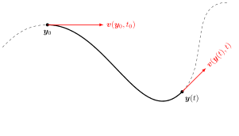
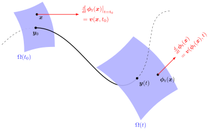
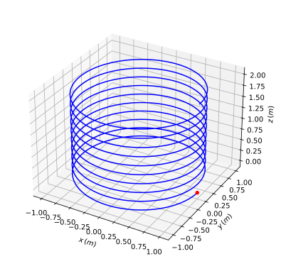
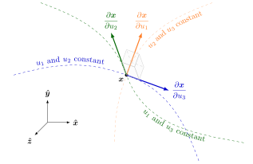

---
numbering:
  enumerator: "3.%s"
  heading_1: true
  heading_2: true
  heading_3: true
---

# 3 Mechanics of fluids
This chapter derives the partial differential equations that describe the time evolution of fluid's density $\rho(\bm{x},t)$, velocity $\bm{v}(\bm{x},t)$, and specific internal energy $u(\bm{x},t)$ as fields dependent on location $\bm{x}$ and time $t$. Later, these equations are used to formulate control-volume engineering models for analysis of power plant and refrigeration systems. The positioning of this chapter within the overall roadmap is illustrated in {numref}`fig-roadmap-chap-03`.

:::{figure} ./figs/fig-roadmap-chap-03.svg
:label: fig-roadmap-chap-03
:align: center
:width: 100%
The positioning of the chapter content with respect to the roadmap.
:::

The derivation of the evolution equations builds on the Leibniz rule for differentiating integrals over time-evolving volumes. Combined with the principles of mass, momentum, and energy conservation, the Leibniz rule enables conversion of fundamental physics principles to locally applicable partial differential equations for the fluid state fields. The discussion focuses on simple fluids often encountered in engineering applications, and the constitutive relations for stress and heat flux are motivated by experimental observations. As a concluding note, the set of partial differential equations obtained from the conservation principles is observed to contain more variables than there are equations for, necessitating a thermodynamic closure via state relations before practical energy engineering applications can be analyzed.

The application of the Leibniz rule to conservation principles involves standard calculus tools, such as the divergence theorem, and constitutes core knowledge for energy engineers. When applying the rule to the principles of momentum and energy conservation, the contact forces that contribute to the time rate of change of momentum and rate of mechanical work on surfaces are expressed in terms of a stress tensor. As tensors are typically not covered during ordinary differential and integral calculus classes, the chapter begins with a brief introduction to them before presenting and interpreting the Leibniz rule.

As supplements to the core knowledge, this chapter includes a full derivation of the Leibniz rule, establishes the stress tensor as a physical necessity to describe contact forces on surfaces, and justifies the symmetry of the stress tensor by conservation of angular momentum. These intermediate and advanced topics are designed for readers seeking deeper theoretical foundation and are not expected to be fully mastered on a first reading. Readers primarily interested in the core engineering path may skip the intermediate and advanced sections and focus directly on the derivation process of the evolution equations.

## Learning goals

- This is 
- a list of
- learning goals

## <span class="elementary"></span> Tensors as mathematical objects
A careful analysis of Newton's second law over a volume of matter shows that any force per unit area resulting from a point-wise contact on the surface of the volume with another volume of matter must be expressible as a linear map of the surface normal vector at the location of contact. While stated here as a fact, the claim is proven rigorously in {numref}`sec-stress-tensor`. Mathematically, an infinitesimal contact force $\delta\bm{F}_s$ acting on an infinitesimal surface area $dA$ at a point with an outward unit surface normal $\bm{\hat{n}}$ is then expressed as

:::{math}
:label: eq-differential-surface-force
\delta\bm{F}_s=\bm{\sigma}\cdot\bm{\hat{n}}dA.
:::

The force, the surface element, and the surface outward unit normal for such setting are illustrated in {numref}`fig-surface-force` with respect to a volume of matter.

:::{figure} ./figs/fig-surface-force.svg
:label: fig-surface-force
:align: center
:width: 50%

A differential surface force $\delta \bm{F}_s$ acting on a differential area $dA$ oriented with respect to an outward unit normal vector $\bm{\hat{n}}$ on a surface of a solid of fluid body.
:::

Since $\delta\bm{F}_s$ on the left side of {numref}`eq-differential-surface-force` is to represent a vector valued quantity, and $\bm{\hat{n}}$ on the right side is also a vector, one may justifiably wonder what type of an object the symbol $\bm{\sigma}$ represents and how exactly does it act as a linear map through the dot product operator $(\cdot)$. 

As an example, consider a block of elastic jello placed on a plate and loaded from the top with a heavy block of mass $m$ as in {numref}`fig-jello`.

::::{figure}
:label: fig-jello
:align: center
:width: 100%

(fig-jello-horizontal)=
:::{image} ./figs/fig-jello-between-plates-horizontal.svg
:alt: An elastic body under horizontal loading
:width: 60%
:::

(fig-jello-tilted)=
:::{image} ./figs/fig-jello-between-plates-tilted.svg
:alt: An elastic body under tilted loading
:width: 60%
:::

Average forces on a surface of an elastic body from loading at different positions.
::::

The total surface force exerted by the block on the top surface of the jello is the integral of the infinitesimal contact force over the top surface area. Since the outward unit normal has the same direction everywhere, it can be pulled out from the integral, and one has
:::{math}
\bm{F}_s=\int_A\delta\bm{F}_s=\int_A\bm{\sigma}\cdot\bm{\hat{n}}dA=\int_A\bm{\sigma}dA \cdot\bm{\hat{n}}.
:::
If the plate is horizontal as in {numref}`fig-jello-horizontal`, the total surface force $\bm{F}_s=m\bm{g}$ is co-linear with the surface unit normal $\bm{\hat{n}}$. This observation would suggest that $\bm{\sigma}$ in general could be some scalar function and the action of it, represented by the dot-product operator $(\cdot)$, could be a simple multiplication with a scalar. However, when the plate is tilted as in {numref}`fig-jello-tilted`, the resulting total surface force no longer aligns with the surface unit normal $\bm{\hat{n}}$. Instead, it has both normal $\bm{F}_n$ and tangential components $\bm{F}_t$ with respect to the surface orientation that are balanced by the friction force $\bm{F}_\mu=-\bm{F}_t$ and the support force $\bm{T}=-\bm{F}_n$. If one is still to trust Newton's second law, the object $\bm{\sigma}$ cannot be simply a scalar valued function and the operator $(\cdot)$ act as scalar multiplication.

Mathematically, $\bm{\sigma}$ is an example of a rank-2 tensor that maps vectors into new vectors with the tensor-vector dot product denoted with $(\cdot)$ representing the action of $\bm{\sigma}$ on $\bm{\hat{n}}$. A general rank-2 tensor $\bm{\sigma}$ in Cartesian coordinates with unit basis vectors $\{\bm{\hat{x}}_i\}_{i=1}^3\in\{\bm{\hat{x}},\bm{\hat{y}},\bm{\hat{z}}\}$ has a representation
:::{math}
\bm{\sigma}=\sum_{i,j=1}^{3}\bm{\hat{x}}_i\otimes\bm{\hat{x}}_j\sigma_{ij}
:::
with $\{\sigma_{ij}\}_{i,j=1}^3$ being a two-dimensional list of real numbers representing the coefficient values of the tensor in the specified coordinate system, in this case the Cartesian coordinates. The list of values can be accessed by dotting the tensor with the associated coordinate basis vector from left and right
:::{math}
\sigma_{ij}=\bm{\hat{x}}_i\cdot\bm{\sigma}\cdot\bm{\hat{x}}_j.
:::
While the two-dimensional list $\{\sigma_{ij}\}_{i,j=1}^3$ can be seen as a matrix, the tensor $\bm{\sigma}$ contains not only the coefficients but also the basis vectors and their tensor product. A tensor therefore should never be misunderstood as just a matrix. If some other coordinate basis is used instead of the Cartesian one, the coefficient values change accordingly, due to changes in the basis vectors. A rank-2 tensor of particular importance is the identity tensor
:::{math}
\bm{I}=\sum_{ij}\bm{\hat{x}}_i\otimes\bm{\hat{x}}_j\delta_{ij},
:::
where $\delta_{ij}$ is the Kronecker delta. Below, the most common rules involving dot product and tensor product are listed. Here $\bm{a}$, $\bm{b}$, and $\bm{c}$ are vectors while $\bm{\sigma}$ and $\bm{\pi}$ are rank-2 tensors, and $\bm{I}$ is the identity tensor.
:::{math}
(\bm{a} \otimes \bm{b}) \cdot \bm{c} &= \bm{a}(\bm{b} \cdot \bm{c}) && \text{Right dot product} \\
\bm{c} \cdot (\bm{a} \otimes \bm{b}) &= (\bm{c} \cdot \bm{a})\bm{b} && \text{Left dot product} \\
\bm{\sigma} : \bm{\pi} &= \sum_{i,j} \sigma_{ij} \pi_{ij} && \text{Double dot product} \\
\bm{I} : \bm{\sigma}&= \sum_{i}\sigma_{ii} && \text{Trace operation} \\
\bm{\sigma}\cdot\bm{a}&= \bm{a}\cdot\bm{\sigma}^T  && \text{Tensor transpose}
:::


## <span class="elementary"></span> Interpretation of the Leibniz integral differentiation rule
Assume the vector field 


## <span class="intermediate"></span> The flow map of a vector field
Assume the vector field $\bm{v}(\bm{x},t)$ to describe which direction fluid is moving at point $\bm{x}$ at time $t$, and at what speed. Drop a small grain of pollen into the fluid at $\bm{y}_0$ at time $t=t_0$. From that moment onwards, the position $\bm{y}(t)$ of the pollen grain will follow the fluid flow and obey the vector-valued ordinary differential equation subject to an initial condition
:::{math}
:label: eq:point-ODE
\frac{d\bm{y}(t)}{dt}=\bm{v}(\bm{y}(t),t), \qquad \bm{y}(t_0)=\bm{y}_0.
:::
Over time, the position $\bm{y}(t)$ draws a curve into space with the tangent vectors of the curve denoting the direction of the local and instantaneous velocity of the grain as in {numref}`fig-point-movement`.

:::::{figure}
:label: fig-point-movement
:align: center



Movement of a point along a vector field.
:::::

Solution to the differential equation {numref}`eq:point-ODE` describing the motion of the pollen grain can be formally expressed with a time-dependent flow map $\bm{\phi}_t(\bm{x})$ associated with the velocity field $\bm{v}(\bm{x},t)$. Starting at time $t_0$, the map moves any point $\bm{x}$, including the $\bm{y}_0$ where the pollen grain was initially dropped, into a new point $\bm{\phi}_t(\bm{x})$ by integrating along the flow of the time-dependent velocity field $\bm{v}(\bm{x},t)$ until time $t$ is reached. The derivative of the flow map with respect to time $t$ therefore corresponds to the velocity field evaluated at the inspected point and time
:::{math}
\frac{d}{dt}\bm{\phi}_t(\bm{x})=\bm{v}(\bm{\phi}_t(\bm{x}),t),
:::
and, at time $t=t_0$, the map reduces to identity $\bm{\phi}_{t_0}(\bm{x})=\bm{x}$. Under the action of the flow map $\bm{\phi}_t$, any set of points $\{\bm{x}|\bm{x}\in\Omega(t_0)\}$ is mapped into an image set $\Omega(t)=\text{Im}_{\bm{\phi}_t}(\Omega(t_0))=\{\bm{\phi}_t(\bm{x})|\bm{x}\in\Omega(t_0)\}$ of the original one as illustrated in {numref}`fig-flowmap`. The map therefore moves not only points but also lines, surfaces, and volumes along the flow of the velocity field $\bm{v}(\bm{x},t)$. For some velocity fields, it is possible to find analytical expressions for the corresponding flow map, but typically the map has to be constructed numerically by integrating the ordinary differential equation {numref}`eq:point-ODE`.

:::::{figure}
:label: fig-flowmap
:align: center



Movement of a general point $\bm{y}(t)$ and the image $\text{Im}_{\bm{\phi}_t}(\Omega(t_0))$ of a domain $\Omega(t_0)$ under the flow map $\bm{\phi}_t(\bm{x})$ of a vector field $\bm{v}(\bm{x},t)$. 
:::::

(example-flowmap-analytical)=
::::{proof:example}
The time-independent vector field $\bm{v}(\bm{x})=\omega(y\bm{\hat{x}}-x\bm{\hat{y}})+v_z\bm{\hat{z}}$, with $\omega$ and $v_z$ constants, has a flow map
:::{math}
:enumerated: false
\bm{\phi}_t(\bm{x})&=\phi_t^x(\bm{x})\bm{\hat{x}}+\phi_t^y(\bm{x})\bm{\hat{y}}+\phi_t^{z}(\bm{x})\bm{\hat{z}}
:::
with the following component functions in the $x$-, $y$-, and $z$-directions
:::{math}
:enumerated: false
\phi_t^x(\bm{x})&=[\cos(\omega(t-t_0))x+\sin(\omega(t-t_0))y]\bm{\hat{x}}\\
\phi_t^y(\bm{x})&=[-\sin(\omega(t-t_0))x+\cos(\omega(t-t_0))y]\bm{\hat{y}}\\
\phi_t^z(\bm{x})&=(z+v_z(t-t_0))\bm{\hat{z}}
:::
This can be verified computing the time derivatives of the component functions
:::{math}
:enumerated: false
\frac{d}{dt}\phi_t^x(\bm{x})&=\omega[-\sin(\omega(t-t_0))x+\cos(\omega(t-t_0))y]=\omega \phi_t^y(\bm{x})\\
\frac{d}{dt}\phi_t^y(\bm{x})&=- \omega[\cos(\omega(t-t_0))x+\sin(\omega(t-t_0))y]=-\omega\phi_t^x(\bm{x})\\
\frac{d}{dt}\phi_t^{z}(\bm{x})&=v_z
:::
so that the time derivative of the flow map can be identified as
:::{math}
:enumerated: false
\frac{d}{dt}\bm{\phi}_t(\bm{x})=\omega(\phi_t^y(\bm{x})\bm{\hat{x}}-\phi_t^x(\bm{x})\bm{\hat{y}})+v_z\bm{\hat{z}}=\bm{v}(\bm{\phi}_t(\bm{x}))
:::

The map describes a helical trajectory with constant angular velocity $\omega$ and translative velocity $v_z$ in the $z$-direction.

::::

::::{proof:example}
The scipy-library offers the method odeint for numerical solution of ordinary differential equations. With the help of it, the flowmap of example {numref}`example-flowmap-analytical` can be computed also numerically. The script below performs numerical construction of the map for one initial location and illustrates the resulting trajectory
```{literalinclude} python/example-flowmap-with-odeint.py
:language: python
:start-line: 0
:end-line: 49
:linenos:
```
Running the script the figure below is produced, confirming the tracjetory to be helical and to expand into $\bm{\hat{z}}$ direction at constant velocity.
:::{figure}
:align: center



:::

::::

If an infinitesimally short line, small patch, or volume of pollen is dropped into the flow instead of a single point-like grain, how exactly will they develop over time? Points are known to move according to the differential equation {numref}`eq:point-ODE` but infinitesimally small lines, surface patches, and volumes differ from points as mathematical objects. What equations will their evolution follow and what are the rates at which these objects change in time? Answering these questions enables one to derive the Leibniz integral differentiation rule. Before setting such infinitesimal objects into motion, one has to understand how the objects constructed in the first place.

## <span class="intermediate"></span> Differential line-, surface, and volume elements
Consider a coordinate triplet $(u_1,u_2,u_3)$ that defines a point $\bm{x}$ in space. In other words, a location in space is a vector-valued function $\bm{x}(u_1,u_2,u_3)$ of the coordinates. A differential, vector-valued line element $d\bm{\ell}_{\bm{x},\alpha}$, into the direction of the coordinate $u_\alpha$ and rooted at $\bm{x}$, is generated by the change in the position $\bm{x}$ with respect to a differential change $du_\alpha$ in the coordinate $u_\alpha$ via the definition
:::{math}
d\bm{\ell}_{\bm{x},\alpha}=\lim_{\epsilon\to0}\frac{\bm{x}(u_\alpha+\epsilon du_\alpha,u_\beta,u_\gamma)-\bm{x}(u_\alpha,u_\beta,u_\gamma)}{\epsilon}=\frac{\partial\bm{x}}{\partial u_\alpha}du_\alpha.
:::
At point $\bm{x}$, the differential line element $d\bm{\ell}_{\bm{x},\alpha}$ has a differential scalar-valued length 
:::{math}
d\ell_{\bm{x},\alpha}=\left|d\bm{\ell}_{\bm{x},\alpha}\right|=\left|\frac{\partial\bm{x}}{\partial u_\alpha}\right|du_\alpha,
:::
and a non-differential unit vector pointing its direction
:::{math}
\bm{\hat{\ell}}_{\bm{x},\alpha}=\frac{\partial \bm{x}/\partial u_\alpha}{\left|\partial\bm{x}/\partial u_\alpha\right|}.
:::
In terms of its length and the unit direction vector, the differential line element can be written equally as
:::{math}
d\bm{\ell}_{\bm{x},\alpha}=\bm{\hat{\ell}}_{\bm{x},\alpha}d\ell_{\bm{x},\alpha}.
:::

A differential, vector-valued, oriented surface element $d\bm{A}_{\bm{x}}=\bm{\hat{n}}_{\bm{x}}dA_{\bm{x}}$, rooted at $\bm{x}$ and having a surface unit normal vector $\bm{\hat{n}}_{\bm{x}}$, can be constructed by considering the oriented area two different differential line elements span. For example, the vector-valued line elements $d\bm{\ell}_{\bm{x},\alpha}$ and $d\bm{\ell}_{\bm{x},\beta}$ create a vector valued oriented surface element $d\bm{A}_{\bm{x},\gamma}$ via the cross-product
:::{math}
d\bm{A}_{\bm{x},\gamma}=d\bm{\ell}_{\bm{x},\alpha}\times d\bm{\ell}_{\bm{x},\beta}=\frac{\partial \bm{x}}{\partial u_\alpha}\times\frac{\partial \bm{x}}{\partial u_\beta}du_\alpha du_\beta.
:::
At point $\bm{x}$, such element has a non-negative, scalar-valued but differential area
:::{math}
dA_{\bm{x},\gamma}=\left|d\bm{A}_{\bm{x},\gamma}\right|=\left|\frac{\partial \bm{x}}{\partial u_\alpha}\times\frac{\partial \bm{x}}{\partial u_\beta}\right|du_\alpha du_\beta,
:::
and a non-differential surface unit normal vector
:::{math}
\bm{\hat{n}}_{\bm{x},\gamma}=\frac{\frac{\partial \bm{x}}{\partial u_\alpha}\times\frac{\partial \bm{x}}{\partial u_\beta}}{\left|\frac{\partial \bm{x}}{\partial u_\alpha}\times\frac{\partial \bm{x}}{\partial u_\beta}\right|}.
:::

Finally, a differential volume element $dV_{\bm{x}}$, rooted at $\bm{x}$, can be constructed by considering the volume all three differential line elements span
:::{math}
dV_{\bm{x}}&=\left|d\bm{\ell}_{\bm{x},\alpha}\times d\bm{\ell}_{\bm{x},\beta}\cdot d\bm{\ell}_{\bm{x},\gamma}\right|%\\
%&=|d\bm{A}_{\bm{x},\gamma}\cdot d\bm{\ell}_{\bm{x},\gamma}|\\
=\left|\frac{\partial \bm{x}}{\partial u_\alpha}\times\frac{\partial \bm{x}}{\partial u_\beta}\cdot\frac{\partial \bm{x}}{\partial u_\gamma}\right|du_\alpha du_\beta du_\gamma.
:::
The absolute value of the scalar triple product of the three directional vectors define the Jacobian $J$ of the coordinate system
:::{math}
    J=\left|\frac{\partial \bm{x}}{\partial u_\alpha}\times\frac{\partial \bm{x}}{\partial u_\beta}\cdot\frac{\partial \bm{x}}{\partial u_\gamma}\right|=\left|\text{det}\begin{pmatrix}
        \frac{\partial x_1}{\partial u_1} & \frac{\partial x_1}{\partial u_2} & \frac{\partial x_1}{\partial u_3} \\
        \frac{\partial x_2}{\partial u_1} & \frac{\partial x_2}{\partial u_2} & \frac{\partial x_2}{\partial u_3} \\
        \frac{\partial x_3}{\partial u_1} & \frac{\partial x_3}{\partial u_2} & \frac{\partial x_3}{\partial u_3}
    \end{pmatrix}\right|,
:::
that on mathematics courses is often introduced as the determinant of the matrix containing the partial derivatives of the coordinates, instead of the geometric view presented here. Both definitions give the same result.
Example coordinate-triplet isolines trough a point $\bm{x}$ and the possible vectors $\partial\bm{x}/\partial u_\alpha$ they generate at the point $\bm{x}$ are illustrated in {numref}`fig-coordinate-vectors`. From the figure, one may observe the vectors to span finite areas and a finite volume. The areas and the volume become differential once the lenght along the vectors are scaled with the associated differentials $du_\alpha$.
:::{figure}
:label: fig-coordinate-vectors
:align: center



Coordinate lines and vectors that define differential line, surface, and volume elements.
:::

::::{proof:example}
A point $\bm{x}$ in 3-D space can be described by the Cartesian coordinate triplet $(x,y,z)$ as
:::{math}
:enumerated: false
\bm{x}=x\bm{\hat{x}}+y\bm{\hat{y}}+z\bm{\hat{z}}.
:::
The same point can be described by the cylindrical coordinate triplet $(r,\vartheta,z)$ as 
:::{math}
:enumerated: false
\bm{x}=r\cos\vartheta\bm{\hat{x}}+r\sin\vartheta\bm{\hat{y}}+z\bm{\hat{z}},
:::
with the coordinates $x$ and $y$ being determined from the cylindrical coordinates according to $x=r\cos\vartheta$ and $y=r\sin\vartheta$.
::::
::::{proof:example}
In cartesian coordinates $(x,y,z)$, the differential line elements at point $\bm{x}$ are
:::{math}
:enumerated: false
d\bm{\ell}_{\bm{x},x}=\bm{\hat{x}}dx, \quad d\bm{\ell}_{\bm{x},y}=\bm{\hat{y}}dy, \quad d\bm{\ell}_{\bm{x},z}=\bm{\hat{z}}dz.
:::
At the same point, they generate differential oriented surface elements such as
:::{math}
:enumerated: false
d\bm{A}_{\bm{x},x}=d\bm{\ell}_{\bm{x},y}\times d\bm{\ell}_{\bm{x},z}=\bm{\hat{y}}\times\bm{\hat{z}}dydz=\bm{\hat{x}}dydz,
:::
and a differential volume element
:::{math}
:enumerated: false
dV_{\bm{x}}=|\bm{\hat{y}}\times\bm{\hat{z}}\cdot\bm{\hat{x}}|dydzdx=dxdydz.
:::
In cylindrical coordinates $(r,\vartheta,z)$, the differential line elements at point $\bm{x}$ are computed to be
:::{math}
:enumerated: false
d\bm{\ell}_{\bm{x},r}&=(\cos\vartheta\bm{\hat{x}}+\sin\vartheta\bm{\hat{y}})dr,\\
d\bm{\ell}_{\bm{x},\vartheta}&=(-r\sin\vartheta\bm{\hat{x}}+r\cos\vartheta\bm{\hat{y}})d\vartheta,\\
d\bm{\ell}_{\bm{x},z}&=\bm{\hat{z}}dz.
:::
They generate differential oriented surface elements such as
:::{math}
:enumerated: false
d\bm{A}_{\bm{x},z}&=d\bm{\ell}_{\bm{x},r}\times d\bm{\ell}_{\bm{x},\vartheta}\\
&=(\cos\vartheta\bm{\hat{x}}+\sin\vartheta\bm{\hat{y}})\times (-r\sin\vartheta\bm{\hat{x}}+r\cos\vartheta\bm{\hat{y}})drd\vartheta\\
&=\bm{\hat{z}}rdrd\vartheta,
:::
and a differential volume element 
:::{math}
:enumerated: false
dV_{\bm{x}}=|d\bm{A}_{\bm{x},z}\cdot d\bm{\ell}_{\bm{x},z}|=rdrd\vartheta dz.
:::
::::

## <span class="advanced"></span> Rank-2 tensors
Similarly as the initial position of a pollen grain dropped into a flowing fluid is mapped into a new position over time, also the vectors 

## <span class="advanced"></span> Evolution of differential elements
Now return to the expression 

## <span class="advanced"></span> Leibniz rule for differentiating integrals
Deriving equations for the evolution of fluid quantities requires differentiating volume integrals over domains that flow with the fluid velocity 

## <span class="elementary"></span> Conservation of mass
Consider a volume 

## <span class="elementary"></span> Conservation of momentum
According to Newton's second law, the rate of change of linear momentum of a body equals the net forces acting on it. The forces acting on a volume of fluid include gravity that is distributed throughout the fluid volume, and mechanical contact force that is distributed on the surface of the body. Since the total force must be finite, yet distributed over the body volume and surface, both the body and surface force need to be treated differentially while the total force is an integral of the differential force. 

(sec-stress-tensor)=
## <span class="advanced"></span> Cauchy's theorem and emerge of the stress tensor

## <span class="intermediate"></span> Conservation of angular momentum and symmetry of the stress tensor
For point masses, the definition 

## <span class="elementary"></span> Conservation of energy
A differential volume 

## <span class="elementary"></span> Constitutive relations for stress and heat flux
The conservation principles of mass, momentum, and energy discussed above lead to local differential equations from which the local time rate of change of fluid's density, velocity, and internal energy ought to be computed. 

## <span class="elementary"></span> Summary
The motion of a fluid can be described by following individual points along the flow and studying how differential line, surface, and volume elements evolve. 
